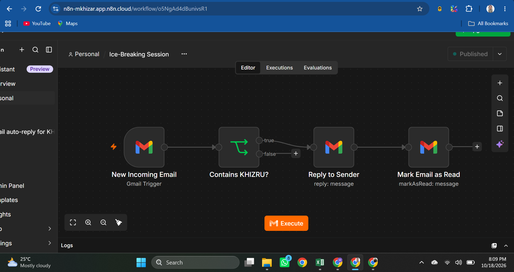
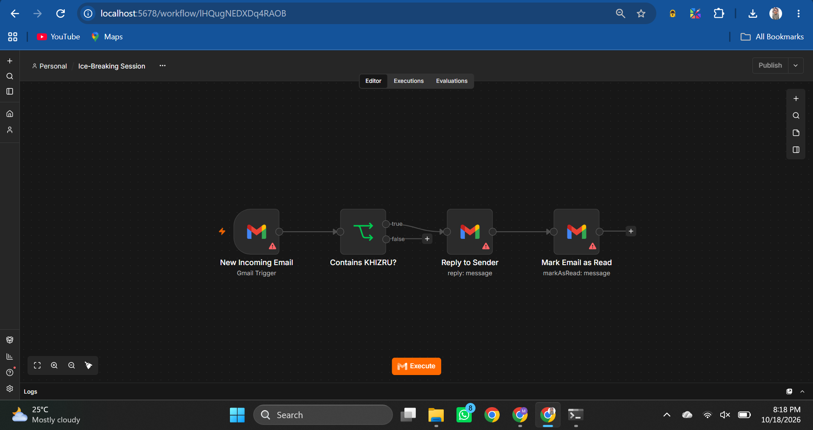
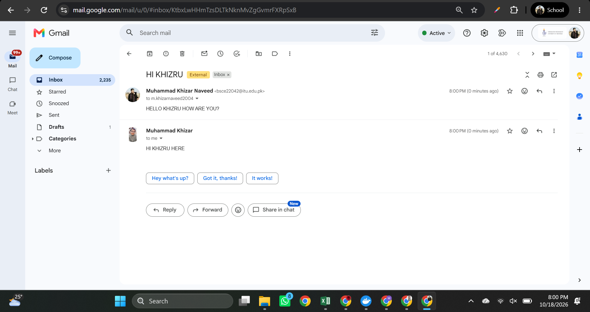
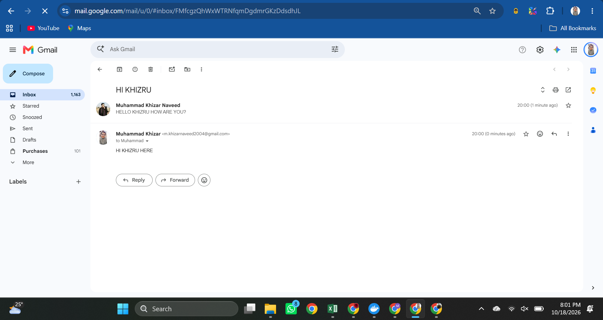

# 🚀 Automated Gmail Auto-Responder (n8n)

> **End-to-end workflow automation project** that monitors a Gmail inbox for keyword-triggered emails and sends automated threaded replies using n8n — deployed on both Cloud and a self-hosted Docker environment.

[](https://n8n.io/)
[](https://www.docker.com/)
[](https://developers.google.com/gmail/api)

---

## 🎯 Project Overview

This project solves a practical automation challenge: **automatically replying to specific emails** without manual intervention. Using n8n's visual workflow editor, I built an event-driven pipeline that:

- Monitors a Gmail inbox every minute for new, unread messages
- Filters incoming emails for a specific keyword (**"KHIZRU"**) using case-insensitive matching
- Sends an automatic threaded reply (`"HI KHIZRU HERE"`) back to the sender
- Marks the processed email as read to prevent infinite re-processing loops

**Key Highlight:** The workflow was first prototyped on **n8n Cloud** (using the AI Assistant), then successfully migrated and deployed to a **local self-hosted Docker instance** to demonstrate cloud-to-self-hosted portability.

---

## 🏗️ Workflow Architecture

```
Gmail Trigger ──► Filter: Contains "KHIZRU"? ──► Gmail: Reply to Sender ──► Gmail: Mark as Read
(Every Minute)         (If Node)                  (Threaded Reply)           (Prevent Re-trigger)
```

| Node | Type | Description |
| :--- | :--- | :--- |
| **New Incoming Email** | Gmail Trigger | Polls inbox every minute for new, unread emails (excludes self-sent) |
| **Contains KHIZRU?** | If (Filter) | Checks if email body/subject contains "KHIZRU" (case-insensitive) |
| **Reply to Sender** | Gmail (Reply) | Sends a threaded reply with `"HI KHIZRU HERE"` |
| **Mark Email as Read** | Gmail (Mark as Read) | Marks the email as read so it won't be picked up again |

---

## 🛠️ Tech Stack

| Category | Technologies |
| :--- | :--- |
| **Workflow Automation** | n8n (Visual Node-Based Editor) |
| **Cloud Platform** | n8n Cloud (Prototyping & Testing) |
| **Containerization** | Docker (Self-Hosted Deployment) |
| **API Integration** | Gmail API, OAuth 2.0 |
| **Version Control** | Git, GitHub |

---

## 🚀 How to Run This Project

### Prerequisites
- Docker installed
- A Google account with Gmail API access

### 1. Clone the Repository
```bash
git clone https://github.com/KhizarNaveed/Ice-Breaking-N8N.git
cd Ice-Breaking-N8N
```

### 2. Pull the n8n Docker Image
```bash
docker pull n8nio/n8n
```

### 3. Start the n8n Container
```bash
docker run -d --name n8n -p 5678:5678 -v n8n_data:/home/node/.n8n n8nio/n8n
```
This will:
- Run n8n in the background on port `5678`
- Create a persistent Docker volume (`n8n_data`) so workflows survive container restarts

### 4. Access the n8n Editor
Open your browser and go to: [http://localhost:5678](http://localhost:5678)

### 5. Import the Workflow
In the n8n editor, use **Import from File** and load `Ice-Breaking Session.json` from this repository.

### 6. Reconnect Gmail Credentials
Since n8n does not export API keys for security, you must manually reconnect Gmail OAuth2 credentials to all three Gmail nodes.

---

## 🐳 Docker Commands Cheat Sheet

| Action | Command |
| :--- | :--- |
| **Pull the image** | `docker pull n8nio/n8n` |
| **Create & start container** | `docker run -d --name n8n -p 5678:5678 -v n8n_data:/home/node/.n8n n8nio/n8n` |
| **Stop the container** | `docker stop n8n` |
| **Start existing container** | `docker start n8n` |
| **View running containers** | `docker ps` |
| **View all containers** | `docker ps -a` |

> **💡 Tip:** If you get a *"name is already in use"* error, the container already exists. Use `docker start n8n` instead of `docker run`.

---

## 📸 Screenshots & Proof of Concept

### n8n Cloud — Workflow Canvas
> The workflow running on n8n Cloud, showing all four nodes in the published state.



### Self-Hosted Docker — Workflow Canvas
> The same workflow imported and running on a local Docker instance at `localhost:5678`.



### Gmail — Test Email (Sender's View)
> The sender's Gmail inbox showing the original email with keyword "KHIZRU" and the automated reply received instantly.



### Gmail — Test Email (Receiver's View)
> The receiver's Gmail inbox confirming the threaded auto-reply `"HI KHIZRU HERE"` was delivered successfully.



---

## 🏗️ Project Architecture

```
├── Ice-Breaking Session.json   # Exported n8n workflow (importable)
├── Results/
│   ├── Cloud/
│   │   └── Web.png             # Screenshot: n8n Cloud workflow canvas
│   ├── Docker/
│   │   └── Image.png           # Screenshot: Self-hosted Docker workflow
│   ├── Test_Sender.png         # Screenshot: Sender's Gmail view
│   └── Test_Reply.png          # Screenshot: Auto-reply confirmation
└── README.md                   # Project documentation
```

---

## 💡 Key Learnings

- **Low-Code Automation:** Designed a node-based workflow using n8n's visual editor
- **AI-Assisted Development:** Leveraged n8n's built-in AI Assistant for rapid prototyping
- **API & OAuth2 Integration:** Authenticated and integrated Google Workspace (Gmail) APIs
- **Cloud-to-Self-Hosted Migration:** Exported a cloud workflow and redeployed it in a local Docker environment
- **Docker & Containerization:** Managed containerized services with persistent data volumes
- **Security Best Practices:** Handled credential re-linking post-migration; understood OAuth token isolation

---

## 🔧 Future Improvements

- [ ] Add more keyword filters for multi-response automation
- [ ] Implement Slack/Discord notifications alongside email replies
- [ ] Deploy on a cloud VM (AWS EC2 / GCP) for 24/7 uptime
- [ ] Add error-handling nodes for failed Gmail API calls
- [ ] Integrate with a database to log all processed emails

---

## 📬 Connect with Me

- **LinkedIn**: [Muhammad Khizar Naveed](https://www.linkedin.com/in/muhammad-khizar-naveed-1767312b2/)
- **GitHub**: [KhizarNaveed](https://github.com/KhizarNaveed)
- **Email**: m.khizarnaveed2004@gmail.com

## 🙏 Acknowledgments

- [n8n](https://n8n.io/) — Open-source workflow automation tool
- [Docker](https://www.docker.com/) — Containerization platform
- [Google Gmail API](https://developers.google.com/gmail/api) — Email integration

---

**⭐ If you found this project useful, please consider giving it a star!**
